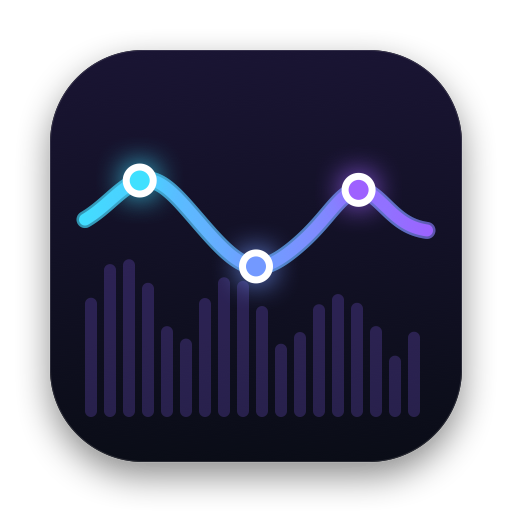
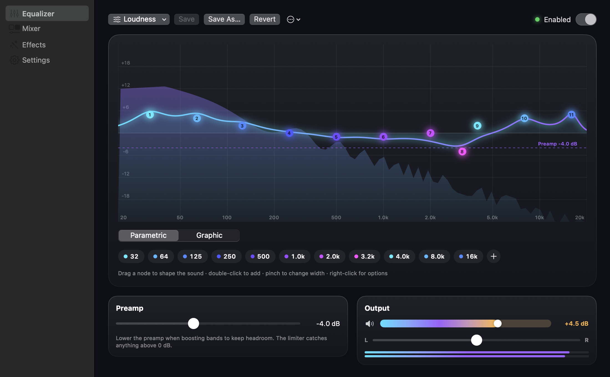
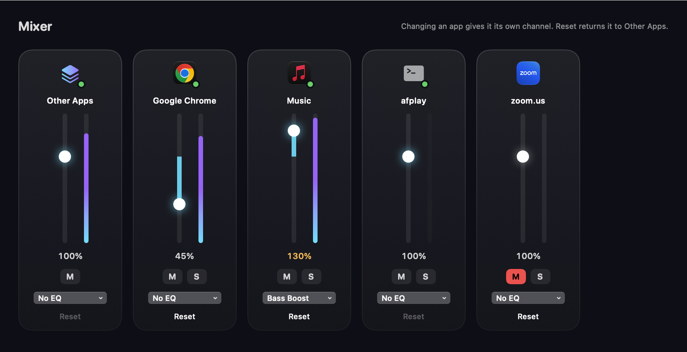
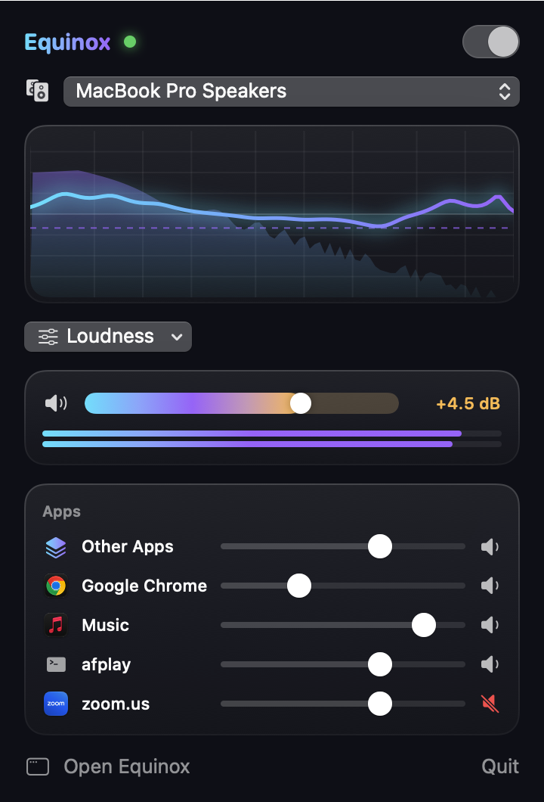
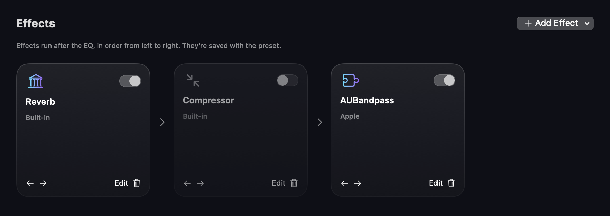
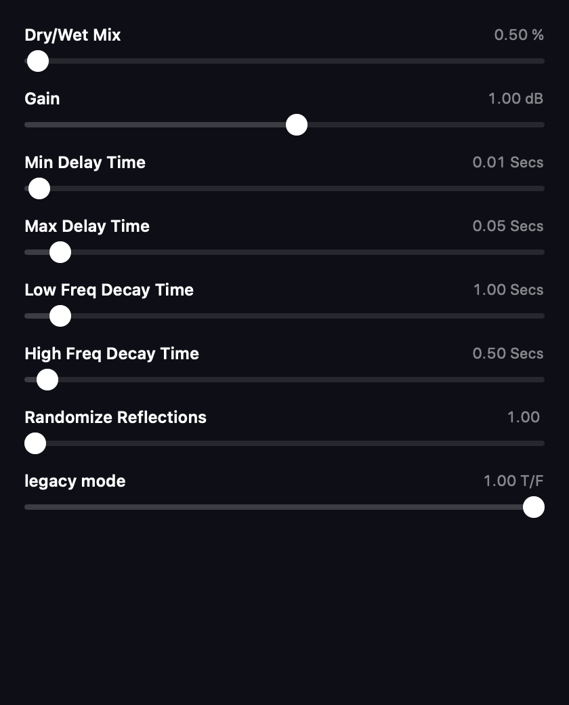
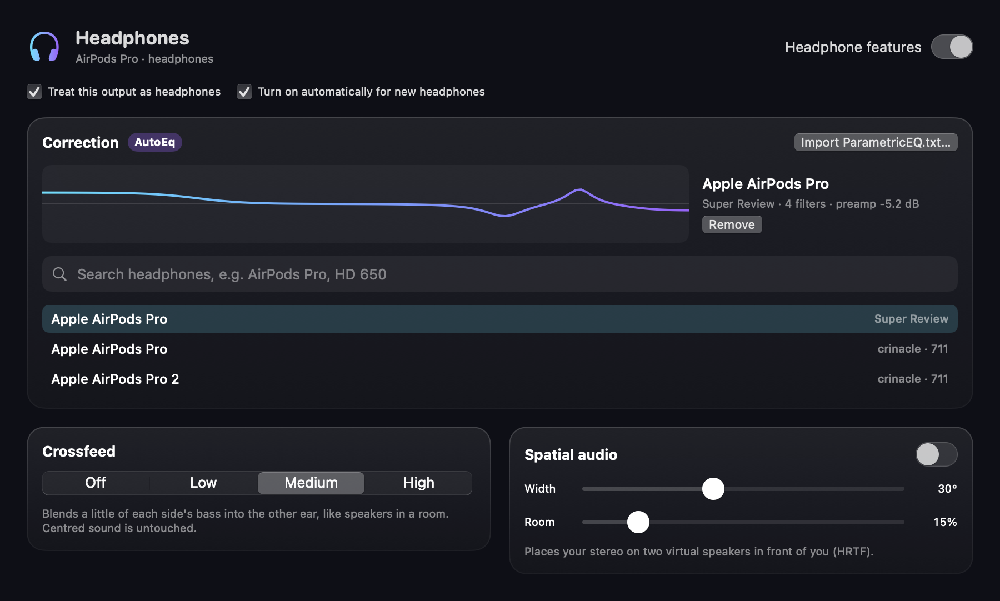

<p align="center">
  
</p>

<h1 align="center">Equinox</h1>

<p align="center">
  <b>A system-wide equalizer, per-app mixer and effects rack for macOS.</b><br>
  Shape everything your Mac plays: no audio driver, no web view, no account.<br>
  Native Swift, built on Core Audio process taps.
</p>

<p align="center">
  
  
  
  
</p>

<p align="center">
  <a href="#install"><b>Install</b></a> ·
  <a href="#features">Features</a> ·
  <a href="#how-it-works">How it works</a> ·
  <a href="#testing">Testing</a> ·
  <a href="#roadmap">Roadmap</a>
</p>

<br>

```sh
curl -fsSL https://raw.githubusercontent.com/north-built-labs/equinox/main/install.sh | bash
```

<p align="center"><sub>One line. Downloads the app, installs it to /Applications and starts it. After that, Equinox updates itself. <a href="#install">More options</a>.</sub></p>

<br>

<p align="center">
  
  <br>
  <sub>The equalizer: drag nodes on a live spectrum. The dashed line is the preamp, and the amber zone is boost above 100%.</sub>
</p>

<br>

<table>
  <tr>
    <td width="25%" valign="top">
      <h3>🔌 No driver</h3>
      Equinox captures audio with macOS's own process taps (macOS 14.2+). There's no kernel extension, no virtual sound card and no admin password. Quit Equinox, or let it crash, and your audio goes straight back to normal.
    </td>
    <td width="25%" valign="top">
      <h3>🎚️ Real parametric EQ</h3>
      Up to 32 bands: peak, shelves, high/low-pass, notch and band-pass. A graphic view, presets, and boost up to +12 dB with a safety limiter that never lets the output clip.
    </td>
    <td width="25%" valign="top">
      <h3>🎛️ Per-app mixer</h3>
      Volume (0–150%), mute, solo and an EQ preset for each app. Chrome's and Safari's helper processes are grouped under the right app automatically.
    </td>
    <td width="25%" valign="top">
      <h3>🎧 Effects & headphones</h3>
      Reverb, compression, delay and any installed Audio Unit, plus AutoEq correction for your headphone model, crossfeed and spatial audio.
    </td>
  </tr>
</table>

<br>

## Features

Every screenshot below is the real app, rendered offscreen from its own views.

<table>
  <tr>
    <td width="50%" valign="top">
      
      <h3>A channel for every app</h3>
      Turn the browser down, push music to 130% with its own EQ, mute a meeting app, or solo one app to hear it alone. Apps you haven't touched share an <i>Other Apps</i> channel. Adjusting an app gives it its own channel with a live meter, and Reset returns it to Other Apps.
    </td>
    <td width="50%" valign="top">
      
      <h3>Everything from the menu bar</h3>
      Power, output device, a mini spectrum, presets, volume and boost, level meters and the apps that are playing, all in one panel. Each output device remembers its own preset, and plugging in headphones switches to theirs.
    </td>
  </tr>
  <tr>
    <td width="50%" valign="top">
      
      <h3>An effects rack after the EQ</h3>
      Build a chain left to right. Bypass any effect live, reorder it, or open its editor: the plugin's own window, or sliders for every parameter. Effects and their settings are saved inside the preset.
    </td>
    <td width="50%" valign="top">
      
      <h3>Plugins, safely</h3>
      Third-party AUv3 plugins load out of process, so a crash can't take Equinox down. AUv2 plugins load in process behind a crash guard: if one crashes while loading, Equinox turns it off on the next launch and tells you. Effect editors offer the plugin's factory presets, and you can drag cards to reorder the chain.
    </td>
  </tr>
  <tr>
    <td width="50%" valign="top">
      
      <h3>Made for headphones</h3>
      Search the <a href="https://github.com/jaakkopasanen/AutoEq">AutoEq</a> database (thousands of measured models) and apply a correction in one click, or import any <code>ParametricEQ.txt</code>. Then add crossfeed (bass from each side reaches the other ear, while centred sound is untouched) or HRTF spatial audio that puts your stereo on two virtual speakers in front of you.
    </td>
    <td width="50%" valign="top">
      <h3>Smart about outputs</h3>
      Equinox knows when you're on headphones (the headphone jack, AirPods and other headphones by name, or your own override). It turns the headphone features on for them, and keeps your jack and speaker settings apart even though macOS reports them as one device.
      <h3>Stays up to date</h3>
      Equinox checks this repo's releases once a day and installs an update with one click. An update is only installed if it carries a valid Ed25519 signature from the project's release key, is really Equinox, and is newer than what you have.
    </td>
  </tr>
</table>

**Music and speech presets:** Pop, Rock, Hip-Hop, R&B / Soul, Jazz, Classical, Metal, Dance, Latin and Ambient join Electronic and Acoustic. For spoken audio, try **Podcast — Clarity** for more vocal presence or **Podcast — Warm** for a softer top end. These are adjustable starting points; use **Save As…** to keep your own version.

**Also in the box:** presets you can import and export (JSON), balance, mute, software volume for outputs without a hardware volume control (HDMI, some DACs), launch at login, and a first-run screen that checks the permission is working.

**Listening:** open the Listening page to enable consistent volume and reactive EQ
for the whole mix. Choose a target level and how much dynamics to preserve, then
soften booming bass, harshness or sibilance with three adjustable dynamic cuts.
Live meters show the gain and cuts being applied. Settings travel with your preset,
and the menu bar has a quick Listening switch. Existing presets start with it off.
Levelling uses stereo RMS (not LUFS), limits automatic gain to +6 dB / −18 dB, and
gates upward adaptation during quiet pauses. Output volume and mute still act after
Listening, followed by the safety limiter. Actual acoustic loudness depends on your
device and volume; audible tuning across music, speech and hardware remains alpha.

## Install

### One line (recommended)

```sh
curl -fsSL https://raw.githubusercontent.com/north-built-labs/equinox/main/install.sh | bash
```

This downloads the latest universal build from [Releases](https://github.com/north-built-labs/equinox/releases), puts it in `/Applications` (or `~/Applications` if `/Applications` isn't writable), and opens it. Running it again updates Equinox in place.

| Option | Command |
|---|---|
| Build from the latest source instead (needs Xcode 16+) | `curl -fsSL …/install.sh \| bash -s -- --from-source` |
| Uninstall (app and settings) | `curl -fsSL …/install.sh \| bash -s -- --uninstall` |

### First run

1. Click the waveform icon in the menu bar, then **Enable Equinox**.
2. macOS asks for **System Audio Recording** permission. Allow it: that's how Equinox hears your Mac's sound. Nothing is recorded or saved.
3. Play some music. The meters in the welcome window should move. If they don't, open *System Settings → Privacy & Security → Screen & System Audio Recording* and make sure Equinox is on.

### Manual download

Download `Equinox-macos.zip` from the [latest release](https://github.com/north-built-labs/equinox/releases/latest), unzip it and drag **Equinox** to Applications. Release builds are ad-hoc signed, not notarized. Browsers mark downloads as quarantined, so macOS will refuse to open the app the first time. Either right-click it and choose **Open**, use *System Settings → Privacy & Security → Open Anyway*, or run:

```sh
xattr -dr com.apple.quarantine /Applications/Equinox.app
```

(The one-line installer doesn't hit this, because `curl` doesn't quarantine files.)

### Build from source

Requirements: macOS 15+, Xcode 16+ (Swift 6).

```sh
git clone https://github.com/north-built-labs/equinox
cd equinox
scripts/build-app.sh --run     # build build/Equinox.app and launch it
swift test                     # unit tests
```

### Releases

Releases are automatic. Every merge into `main` runs [`.github/workflows/release.yml`](.github/workflows/release.yml), which:

1. builds the universal app and runs the tests,
2. picks the version: `Resources/Info.plist`'s version if it's newer than the latest release, otherwise the latest release with its patch number bumped,
3. signs the zip with the release key (the `EQUINOX_SIGNING_KEY` secret on the `production` environment, which only `main` can use), checked against the public key embedded in the app,
4. installs the currently published release and runs its real updater against the new zip; nothing is published unless it accepts the signature and updates itself,
5. publishes a GitHub release. The one-line installer and the in-app updater pick it up.

`main` is protected: changes land through pull requests, and the `lint` and `build` checks must pass.

**Release signatures:** each release carries `Equinox-macos.zip.sig` (checked by the in-app updater) and `Equinox-macos.zip.sshsig` (the same Ed25519 key in OpenSSH format, checked by `install.sh` with `ssh-keygen -Y verify`, so the one-liner refuses an archive the release key didn't sign). Every release also gets a build provenance attestation: `gh attestation verify Equinox-macos.zip -R north-built-labs/equinox`. Releases wait for a reviewer to approve the `production` deployment.

**Rotating the signing key:** put the new key's public half in `Sources/EquinoxCore/Updates.swift`, add its OpenSSH form as a second line in `RELEASE_SIGNERS` in `install.sh` (keep the old line until the rotation release is out), and on the `production` environment store the new key as `EQUINOX_SIGNING_KEY` and the old one as `EQUINOX_PREVIOUS_SIGNING_KEY`. The first release then uses the old key's signatures (the published release doesn't trust the new key yet) and every later one the new key's. Once that release is out, delete `EQUINOX_PREVIOUS_SIGNING_KEY` and the old `install.sh` line; anyone who skipped it reinstalls with the one-liner.

To start a new minor or major version, raise `CFBundleShortVersionString` in `Resources/Info.plist` in your pull request. Pull requests get a build and a test run, and the built app is attached as a workflow artifact. A local build signs with your *Apple Development* certificate if you have one, so macOS remembers the audio permission across rebuilds.

## How it works

```
 every app ──► Core Audio process taps (muted at source while Equinox runs)
                 ├─ "Other Apps" tap: everything except Equinox and the apps you've customised
                 └─ one tap per customised app
                          │
                 private aggregate device, clocked by your real output
                          │  IOProc (realtime thread)
                          ▼
   per-app strips: EQ → volume/mute ─┐
                                     ├─► sum ─► headphone correction (AutoEq) ─► EQ (32 biquads, vDSP)
   ...                              ─┘     ─► effects (AVAudioEngine, realtime manual rendering)
                                           ─► crossfeed or HRTF spatial ─► Listening ─► volume · balance · boost
                                                                         ─► peak limiter (−0.3 dBFS) ─► speakers
```

- **No driver.** The taps mute the original audio only while Equinox's session exists. When Equinox quits or crashes, macOS removes the taps and playback is normal again.
- **Realtime-safe.** Nothing on the audio thread allocates, locks or logs. Settings, effect chains and engines reach the audio thread through a lock-free mailbox. They are released only after the audio thread confirms it has moved on, so nothing is ever freed mid-render.
- **Glitch-free changes.** EQ edits ramp their coefficients and gains. A session rebuild (device switch, new app channel) builds the new session before tearing down the old one. When only an app's helper processes change, its tap is retargeted in place.
- **Modules.** `EquinoxDSP` (pure DSP, no Core Audio), `EquinoxAudio` (taps, devices, effects host), `EquinoxCore` (app state, presets, persistence) and `Equinox` (SwiftUI). The design and the plan for each phase are in [`docs/superpowers`](docs/superpowers).

## Testing

```sh
swift test               # ~175 unit tests: DSP, renderer, mixer, effects engine, presets, app model
scripts/self-test.sh     # live end-to-end checks on your real audio hardware
```

`self-test.sh` plays two quiet test tones (1 kHz and 2.5 kHz, about a minute and a quarter in total) and measures what Equinox actually outputs at those exact frequencies. Other audio playing at the same time doesn't disturb it. It also renders the screenshots above.

```
PASS  tap captures system audio — 1 kHz tone measured at -30.00 dBFS
PASS  +12 dB peak at 1 kHz — Δ +12.00 dB
PASS  limiter holds −0.3 dBFS ceiling — peak -0.30 dBFS
PASS  per-app: Other Apps fader doesn't touch a dedicated app — Δ -0.00 dB
PASS  multi: 3 strips map to the right apps — Δ -6.02/-12.04, swapped -12.04/-6.02
PASS  effects: installed Audio Unit (AUBandpass) runs — Δ -25.03 dB
PASS  no feedback after playback stops — 1 kHz residual -180.00 dBFS
PASS  headphones: crossfeed keeps centred audio unchanged — Δ +0.00 dB
RESULT: all 29 checks passed
```

## Roadmap

- [x] **Engine & EQ:** driver-free capture, 32-band parametric/graphic EQ, presets, boost and limiter, per-device memory
- [x] **Per-app mixer:** volume, mute, solo and EQ per app
- [x] **Effects & plugins:** built-in effects, Audio Unit hosting, crash protection
- [x] **Headphones:** AutoEq correction, crossfeed, HRTF spatial audio, headphone detection
- [x] **In-app updates:** signed releases, one-click install
- [x] **Listening:** opt-in master volume levelling, dynamics control and three reactive EQ bands
- [ ] Notarized builds (needs an Apple Developer ID)

> [!IMPORTANT]
> **Status: alpha.** Every audio path is covered by measured end-to-end checks, run on Apple silicon with built-in speakers and a Bluetooth headset. It hasn't yet seen other hardware, unusual audio interfaces or third-party plugins, so expect rough edges. If something sounds wrong, Equinox's **Enabled** switch or **Quit** always returns your audio to normal. Please [open an issue](https://github.com/north-built-labs/equinox/issues) with your macOS version and output device.

## Acknowledgements

Equinox was inspired by [eqMac](https://eqmac.app) and set out to match the features of eqMac Pro. It is an independent, clean-room implementation: no eqMac code, assets or licence logic are used, and it isn't affiliated with eqMac or Bitgapp.
